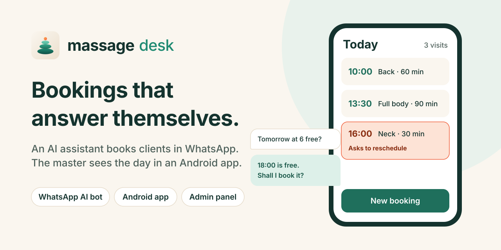
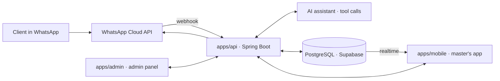

<p align="center">
  
</p>

<p align="center">
  <a href="https://github.com/nurbolatdev/massage-desk/actions/workflows/ci.yml"></a>
  <a href="LICENSE"></a>
  
  <br>
  
  
  
  
  
</p>

<p align="center">
  <a href="#why">Why</a> ·
  <a href="#features">Features</a> ·
  <a href="#how-it-works">How it works</a> ·
  <a href="#repository">Repository</a> ·
  <a href="#getting-started">Getting started</a> ·
  <a href="#roadmap">Roadmap</a> ·
  <a href="#documentation">Docs</a> ·
  <a href="#license">License</a>
</p>

---

## Why

A massage therapist gets most bookings through WhatsApp and answers between sessions. Replies are late, the schedule lives in a notebook, clients forget their visits.

**massage desk** answers instantly, offers only truly free times, confirms, reminds — and hands the conversation to the master whenever a human is needed.

## Features

<table>
  <tr>
    <td width="33%" valign="top">
      <h3>💬 For clients</h3>
      <ul>
        <li>Book in WhatsApp — no app to install</li>
        <li>Only truly free times are offered</li>
        <li>Confirmation before every booking</li>
        <li>Reminders before the visit</li>
      </ul>
    </td>
    <td width="33%" valign="top">
      <h3>📱 For the master</h3>
      <ul>
        <li>Today's visits at a glance</li>
        <li>Calendar, manual booking, days off</li>
        <li>Chats that need a human, highlighted</li>
        <li>Large text, one main action per screen</li>
      </ul>
    </td>
    <td width="33%" valign="top">
      <h3>🖥️ For the admin</h3>
      <ul>
        <li>Schedule, clients, services, settings</li>
        <li>Conversations and AI diagnostics</li>
        <li>Event log, reports, system health</li>
        <li>Everything the bot did, explained</li>
      </ul>
    </td>
  </tr>
</table>

## How it works



- **The schedule is computed in code.** The AI assistant understands intent and calls tools (`find_slots`, `create_booking`, …); availability, prices and bookings always come from the database.
- **Double booking is impossible at the database level** — an exclusion constraint on appointment time ranges, covered by integration tests.
- **Confirmation before booking** and **hand-off to the master** for medical questions, complaints or uncertainty.
- **Observable by design:** domain events, AI runs and webhook deliveries feed the admin panel's statistics and diagnostics.

## Repository

| Path | What | Stack |
|---|---|---|
| [`apps/api`](apps/api) | REST API, WhatsApp webhook, AI assistant, scheduling, reminders | Java 21, Spring Boot 4.1, Maven, Flyway, JPA, Testcontainers |
| [`apps/mobile`](apps/mobile) | Android app for the master: today, calendar, chats, settings | Expo SDK 58, React Native, Expo Router, TypeScript |
| [`apps/admin`](apps/admin) | Admin panel: schedule, clients, conversations, AI diagnostics, reports, system | React, Vite, TanStack, shadcn/ui, Recharts |
| [`packages/shared`](packages/shared) | TypeScript helpers shared by the app and the admin panel | TypeScript, zod |
| [`packages/api-types`](packages/api-types) | TypeScript types generated from the API contract | openapi-typescript |
| [`assets/brand`](assets/brand) | Logo sources and generated images | SVG, `npm run brand` |
| [`docs`](docs) | Architecture, data model, API, design language, roadmap | Markdown |

## Getting started

**Requirements:** Java 21, Node 22+, Docker (local database and tests).

```bash
git clone https://github.com/nurbolatdev/massage-desk.git && cd massage-desk

npm install                      # TypeScript workspaces (builds packages/shared)
npm run check                    # quality gate: API verify + lint, typecheck, tests → GATE PASS
```

Run it locally:

```bash
cd apps/api && ./mvnw spring-boot:run   # API on http://localhost:8080 — Postgres starts from compose.yaml
npm run dev:mobile                      # Expo dev server — open in Expo Go on Android
npm run dev:admin                       # admin panel (Vite dev server)
```

<details>
<summary><b>Configuration, API types and iOS simulator</b></summary>

- **Configuration:** `apps/api/.env.example` for the API, `apps/mobile/.env.example` for the app (copy it to `apps/mobile/.env`). Secrets never go to git.
- **API types:** `npm run api:types` regenerates `apps/api/openapi.json` and `packages/api-types` (needs Docker). Commit both when an endpoint changes — the gate fails if they are out of date.
- **iOS simulator:** `cd apps/mobile && npx expo start --ios`. With Xcode 27 the simulator opens in Device Hub (Simulator.app no longer exists). Start the API first.
- **Brand images:** `npm run brand` rebuilds the logo, app icons, social preview and this README banner from `scripts/brand/generate.mjs`.

</details>

## Roadmap

Built in vertical slices — every milestone ends with something the master can use. Every task is one branch and one pull request; the full plan with branches and commits is in [docs/roadmap.md](docs/roadmap.md).

| Milestone | Result | Release |
|---|---|---|
| **M0 · Foundation** | Repository, CI, database schema, API and app skeletons, docs | — |
| **M1 · Schedule** ← *now* | The master runs the schedule in the app; admin panel basics; event log; deploy and APK | v0.1 |
| **M2 · Button bot** | Clients book themselves in WhatsApp with buttons; chats in the app and the admin panel | v0.2 |
| **M3 · AI assistant** | Free-text understanding, guardrails, evals, AI diagnostics | v0.3 |
| **M4 · Notifications & reports** | Push, reminders, morning summary, dashboard and reports | v0.4 |
| **M5 · Pilot → v1.0** | Two-week pilot, fixes, monitoring, system health, release | v1.0 |

[Milestones](https://github.com/nurbolatdev/massage-desk/milestones) · [Issues](https://github.com/nurbolatdev/massage-desk/issues)

## Documentation

| | |
|---|---|
| **System** | [Architecture](docs/architecture.md) · [Data model](docs/data-model.md) · [API](docs/api.md) · [Decisions](docs/decisions.md) |
| **Channels** | [WhatsApp](docs/whatsapp.md) · [AI assistant](docs/ai-assistant.md) |
| **Apps** | [Mobile app](docs/mobile.md) · [Admin panel](docs/admin.md) · [Design language](docs/design.md) |
| **Process** | [Roadmap](docs/roadmap.md) · [Contributing](CONTRIBUTING.md) |

## Contributing

Branch from `develop`, one task per branch, [Conventional Commits](https://www.conventionalcommits.org/), and `npm run check` must print `GATE PASS` before every commit. Details in [CONTRIBUTING.md](CONTRIBUTING.md).

## License

[MIT](LICENSE) © 2026 Nurbolat Djumadilov
