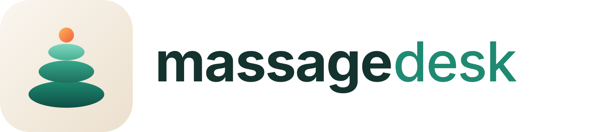
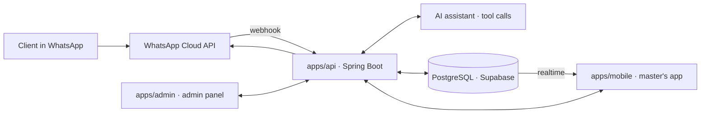

<p align="center">
  
</p>

<p align="center">
  <b>Booking automation for a massage therapist.</b><br>
  An AI assistant answers clients in WhatsApp and books them, the master sees the schedule in an Android app,
  the admin panel shows everything that happens.
</p>

<p align="center">
  <a href="https://github.com/nurbolatdev/massage-desk/actions/workflows/ci.yml"></a>
  
  
  
  
</p>

---

## Why

A massage therapist gets most bookings through WhatsApp and answers between sessions. Replies are late, the schedule lives in a notebook, clients forget their visits. **massage desk** answers instantly, offers only truly free times, confirms, reminds — and hands the conversation to the master whenever a human is needed.

## How it works



- **The schedule is computed in code.** The AI assistant understands intent and calls tools (`find_slots`, `create_booking`, …); availability, prices and bookings always come from the database.
- **Double booking is impossible at the database level** — an exclusion constraint on appointment time ranges, covered by integration tests.
- **Confirmation before booking** and **hand-off to the master** for medical questions, complaints or uncertainty.
- **Observable by design:** domain events, AI runs and webhook deliveries feed the admin panel's statistics and diagnostics.

## Repository

| Path | What | Stack |
|---|---|---|
| `apps/api` | REST API, WhatsApp webhook, AI assistant, scheduling, reminders | Java 21, Spring Boot 4.1, Maven, Flyway, JPA, Testcontainers |
| `apps/mobile` | Android app for the master: today, calendar, chats, settings | Expo SDK 58, React Native, Expo Router, TypeScript |
| `apps/admin` | Admin panel: schedule, clients, conversations, AI diagnostics, reports, system *(M1)* | React, Vite, TanStack, shadcn/ui, Recharts |
| `packages/shared` | TypeScript helpers shared by the app and the admin panel | TypeScript, zod |
| `assets/brand` | Logo sources and generated images | SVG, `npm run brand` |

## Getting started

Requirements: Java 21, Node 22+, Docker (local database and tests).

```bash
npm install                      # TypeScript workspaces (builds packages/shared)
npm run check                    # quality gate: API verify + lint, typecheck, tests

cd apps/api && ./mvnw spring-boot:run   # API on http://localhost:8080 — Postgres starts from compose.yaml
npm run dev:mobile                      # Expo dev server — open in Expo Go on Android
```

Configuration: `apps/api/.env.example`. Secrets never go to git.

## Roadmap

Built in vertical slices — every milestone ends with something the master can use. Every task is one branch and one pull request; the full plan with branches and commits is in [docs/roadmap.md](docs/roadmap.md).

| Milestone | Result | Release |
|---|---|---|
| **M0 · Foundation** | Repository, CI, database schema, API and app skeletons, docs | — |
| **M1 · Schedule** | The master runs the schedule in the app; admin panel basics; event log; deploy and APK | v0.1 |
| **M2 · Button bot** | Clients book themselves in WhatsApp with buttons; chats in the app and the admin panel | v0.2 |
| **M3 · AI assistant** | Free-text understanding, guardrails, evals, AI diagnostics | v0.3 |
| **M4 · Notifications & reports** | Push, reminders, morning summary, dashboard and reports | v0.4 |
| **M5 · Pilot → v1.0** | Two-week pilot, fixes, monitoring, system health, release | v1.0 |

[Milestones](https://github.com/nurbolatdev/massage-desk/milestones) · [Issues](https://github.com/nurbolatdev/massage-desk/issues)

## Documentation

[Architecture](docs/architecture.md) · [Data model](docs/data-model.md) · [API](docs/api.md) · [WhatsApp](docs/whatsapp.md) · [AI assistant](docs/ai-assistant.md) · [Mobile app](docs/mobile.md) · [Admin panel](docs/admin.md) · [Decisions](docs/decisions.md) · [Roadmap](docs/roadmap.md) · [Contributing](CONTRIBUTING.md)
