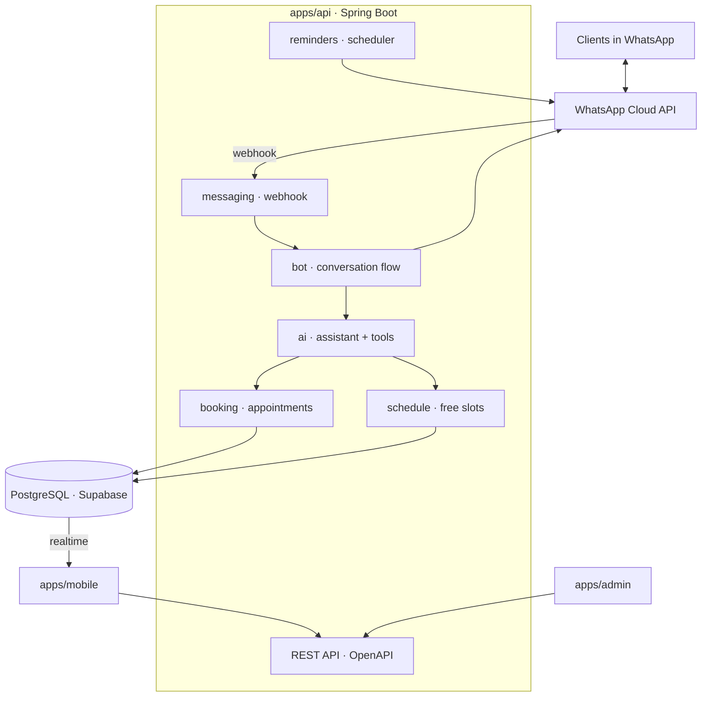

# Architecture

## Components


## Principles
1. **Code owns the schedule.** The AI assistant classifies intent and calls tools; free times, prices and bookings come from deterministic code and the database.
2. **The database guards consistency.** An exclusion constraint makes overlapping confirmed appointments impossible, even under concurrent requests.
3. **Human in the loop.** Any conversation can switch to "master answers"; the assistant escalates medical questions, complaints and uncertainty.
4. **Observable by design.** Domain events, AI runs and webhook deliveries are stored from the first release so the admin panel has history.
5. **One contract.** The API publishes OpenAPI; the app and the admin panel use generated TypeScript types.

## API structure (package by feature)
```
com.massagedesk.api
├── schedule     free slot calculation, working hours, time off
├── booking      appointments, conflicts, domain events
├── clients      clients and notes
├── messaging    WhatsApp webhook and client
├── bot          conversation flow (buttons)
├── ai           AI assistant: model client, tools, guardrails, run log
├── reminders    scheduled reminders
├── admin        statistics and diagnostics
└── security     Supabase JWT, roles
```

## Flow: a client books in WhatsApp
1. Meta delivers the message to `POST /webhook/whatsapp`; the signature is verified, the delivery logged and deduplicated by message id.
2. If the master took over the conversation, the bot stays silent and the master gets a push.
3. The bot or the AI assistant answers from data, offers free times (interactive list) or escalates.
4. After the client confirms, the booking service inserts the appointment; the database rejects any overlap (`409` to callers).
5. The client gets a confirmation; the master's app updates in real time and receives a push.

## Environments
| | Database | API | Mobile |
|---|---|---|---|
| local | PostgreSQL from `compose.yaml` (auto-started) | `./mvnw spring-boot:run` | Expo Go / dev build |
| dev | Supabase project `massage-desk-dev` (profile `supabase`) | local | dev build |
| prod | Supabase project `massage-desk-prod` | Render, deployed from `main` | APK via EAS |
