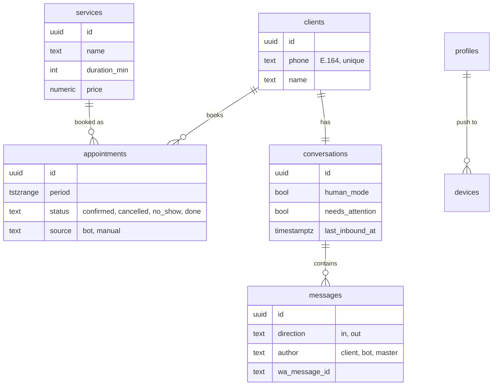

# Data model

Source of truth: Flyway migrations in [`apps/api/src/main/resources/db`](../apps/api/src/main/resources/db).

- `migration/` — portable PostgreSQL schema (local, tests, Supabase).
- `migration-supabase/` — only with profile `supabase`: link to Supabase Auth, row level security, realtime.
- `seed-dev/` — only with profile `seed`: placeholder services and working hours (repeatable, idempotent). Never enable on prod.

## Connecting to the Supabase dev project
1. In the project dashboard open **Connect** and copy the **session pooler** connection details (port 5432).
2. Create `apps/api/.env` (git-ignored) from `apps/api/.env.example`:
   `DATABASE_URL=jdbc:postgresql://<pooler-host>:5432/postgres?sslmode=require`, `DATABASE_USER=postgres.<project-ref>`, `DATABASE_PASSWORD`, `SUPABASE_URL=https://<project-ref>.supabase.co` (no trailing slash; used to verify staff tokens, required with profile `supabase`).
3. Run from `apps/api`: `./mvnw spring-boot:run -Dspring-boot.run.profiles=supabase,seed`.
   The `supabase` profile reads `.env` and applies both migration locations; `seed` adds the dev data.
   For prod use `supabase` only.
4. Once per Supabase project, in the SQL editor, close Flyway's own table to the REST API:
   `alter table public.flyway_schema_history enable row level security;` (no policies on purpose).
   It cannot be a migration: Flyway holds a lock on that table while migrating, so the statement times out.

All timestamps are `timestamptz` (UTC); apps display them in `settings.time_zone`.



Also: `working_hours` (ISO weekday 1–7, several blocks per day for breaks), `time_off`, `settings` (single row), `profiles` (roles `master` / `admin`), `devices` (push tokens).

## Row level security (Supabase)
Only with profile `supabase` (`migration-supabase/`). Every policy is select-only and for the `authenticated` role:
- `staff_read` — `is_staff()`, on all business tables and the three log tables.
- `own_profile_read` — on `profiles` a staff member sees only their own row.

There are no insert/update/delete policies: an insert through the Supabase REST API fails (SQLState `42501`), an update or delete changes no rows. Every write goes through the API, which connects as the table owner and is not limited by RLS. `flyway_schema_history` is closed manually (see step 4 above). Without that step a staff token can also update or delete the migration history through the REST API.

The comments in `V1_1` ("API is not limited") and `V3` ("staff may write these tables directly") are outdated: the current rule is read-only RLS from `V3_1`. Applied migrations are not edited because of Flyway checksums. `V3_1` also pins `is_staff()` to `search_path = public, pg_temp`.

Covered by `SupabasePoliciesTests` on a stand-in database (roles, `auth.uid()` and the realtime publication recreated by a script). It does not cover JWT verification and role switching by PostgREST, the exact grants of a real project, Realtime's own checks, or which role the API uses on Supabase dev and prod.

## Schedule constraints
- `clients_phone_e164` — phones are stored in E.164 (`+` and 9 to 15 digits).
- `time_off_period_bounded` — a time off period is a finite half-open range `[start, end)`.
- `working_hours_no_overlap` — working hour blocks of one day neither overlap nor touch.

The API validates first (400/422); the constraints guard direct writes. Covered by `ScheduleConstraintsTests`.

## No double booking
```sql
constraint appointments_no_overlap
    exclude using gist (period with &&) where (status = 'confirmed')
```
`[start, end)` ranges allow back-to-back appointments; cancelled ones free the time. Covered by `AppointmentOverlapConstraintTests`. One schedule lock (a transaction-scoped advisory lock) orders booking, rescheduling, adding time off, replacing working hours and changing the time zone, so parallel writes queue up instead of deadlocking and never check each other's uncommitted rows; the constraint still decides overlaps. Settings updates also lock the settings row, after the schedule lock, so a parallel change of the address or the bot switch cannot write an old time zone back.

## Observability (append-only)
- `events` — domain event log: `type` (e.g. `appointment_created`), `entity_type`, `entity_id`, `actor` (client, bot, master, admin, system), `payload` (jsonb object).
  `entity_id` has no foreign key: it may point to any table, and events outlive deleted rows.
- `ai_runs` — one row per AI assistant call: model, prompt version, intent, status, tokens, cost, latency, tool calls, error.
- `webhook_logs` — incoming WhatsApp webhooks: signature check, processing status, error, raw payload.

All three are indexed by `created_at`. The API writes them; on Supabase staff can only read them (RLS policy `staff_read`).
Domain events are written by `DomainEventRecorder` inside the caller's transaction (propagation `MANDATORY`).

Appointment events (entity type `appointment`, written by `AppointmentService` in the same transaction as the change; payload: ids and ISO-8601 UTC times only, no names or phones):
- `appointment_created` — `client_id`, `service_id`, `start`, `end`, `source`
- `appointment_rescheduled` — `client_id`, `service_id`, `previous_start`, `previous_end`, `start`, `end`
- `appointment_cancelled`, `appointment_no_show` — `client_id`, `service_id`, `start`, `end`

Client events (entity type `client`, written by `ClientService` in the changing transaction, actor from the token role):
- `client_created` — payload `{}`
- `client_updated` — only when something really changed; payload as below, with the changed fields `name` and/or `notes` named only

Service events (entity type `service`, written by `ServiceCatalog`):
- `service_created` — snapshot: `name`, `duration_min`, `price` (plain decimal string), `sort_order`
- `service_updated`, `service_deactivated` — change payload over `name`, `duration_min`, `price`, `sort_order`, `active`; a change that turns `active` from true to false is `service_deactivated`, any other effective change (reactivation included) is `service_updated`

Schedule and settings events (written in the changing transaction, after the change is flushed; a refused change writes none):
- `working_hours_replaced` — entity-less (`entity_id` null); `from`/`to` are the whole old and new week as `[{"weekday": 1, "start": "09:00", "end": "13:00"}, ...]` ordered by weekday and start, `forced` (the `force` flag of the request), `conflict_ids` (confirmed appointments left outside the new week); an identical week writes no event
- `time_off_created` — entity type `time_off`; `start`, `end` (ISO-8601 UTC), `forced`, `conflict_ids` (confirmed appointments inside the period); the free-text reason is not copied
- `time_off_deleted` — entity type `time_off`; `start`, `end`
- `settings_changed` — entity-less; change payload over `time_zone`, `address` (named only, personal) and `bot_enabled`, plus `forced` (the `force` flag of the request) and `conflict_ids` (confirmed appointments that the new zone leaves outside the working hours; empty when the zone did not change or every appointment still fits)

Change payload: `{"changed": [field, ...], "from": {...}, "to": {...}}`, snake_case field names. `from`/`to` hold values only for fields that are not personal data; personal fields (client `name` and `notes`) appear in `changed` only, because events are append-only and outlive the rows, so personal text copied there could never be erased. A change that changes nothing writes no event. Some events are not about a single entity and are stored with `entity_id` null (`DomainEventRecorder.record(type, actor, payload)`).

The actor comes from the token role (`master` or `admin`); the bot will use `bot`. A refused action writes no event.
