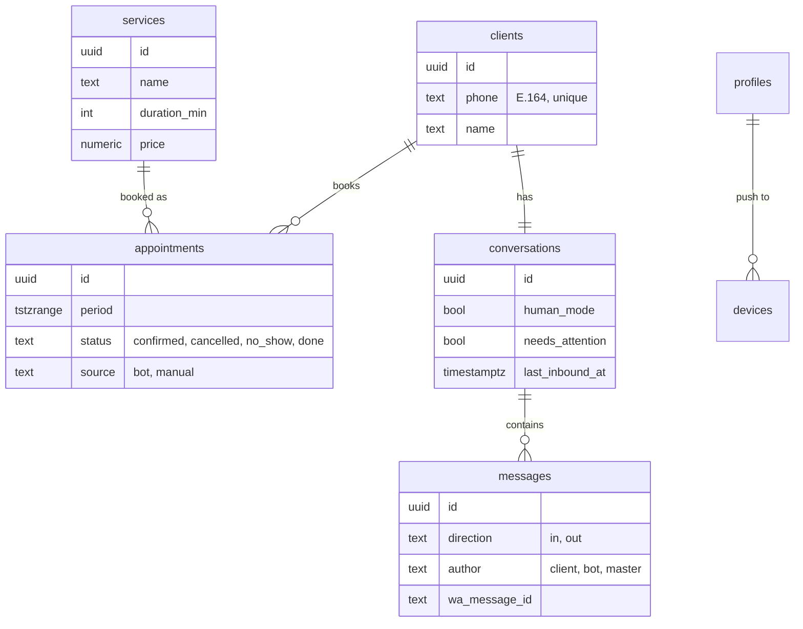

# Data model

Source of truth: Flyway migrations in [`apps/api/src/main/resources/db`](../apps/api/src/main/resources/db).

- `migration/` — portable PostgreSQL schema (local, tests, Supabase).
- `migration-supabase/` — only with profile `supabase`: link to Supabase Auth, row level security, realtime.

All timestamps are `timestamptz` (UTC); apps display them in `settings.time_zone`.



Also: `working_hours` (ISO weekday 1–7, several blocks per day for breaks), `time_off`, `settings` (single row), `profiles` (roles `master` / `admin`), `devices` (push tokens).

## No double booking
```sql
constraint appointments_no_overlap
    exclude using gist (period with &&) where (status = 'confirmed')
```
`[start, end)` ranges allow back-to-back appointments; cancelled ones free the time. Covered by `AppointmentOverlapConstraintTests`.

## Planned (M1)
`events` (domain event log), `ai_runs` (model, tokens, cost, latency, tool calls, errors), `webhook_logs`.
