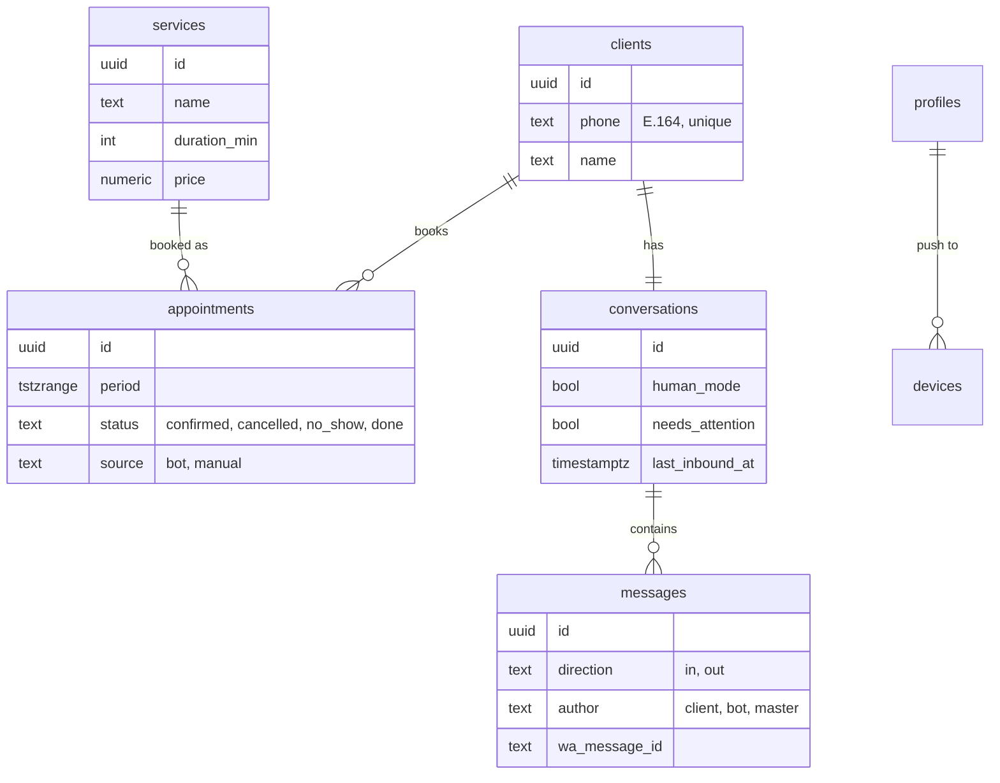

# Data model

Source of truth: Flyway migrations in [`apps/api/src/main/resources/db`](../apps/api/src/main/resources/db).

- `migration/` — portable PostgreSQL schema (local, tests, Supabase).
- `migration-supabase/` — only with profile `supabase`: link to Supabase Auth, row level security, realtime.
- `seed-dev/` — only with profile `seed`: placeholder services and working hours (repeatable, idempotent). Never enable on prod.

## Connecting to the Supabase dev project
1. In the project dashboard open **Connect** and copy the **session pooler** connection details (port 5432).
2. Create `apps/api/.env` (git-ignored) from `apps/api/.env.example`:
   `DATABASE_URL=jdbc:postgresql://<pooler-host>:5432/postgres?sslmode=require`, `DATABASE_USER=postgres.<project-ref>`, `DATABASE_PASSWORD`, `SUPABASE_URL`.
3. Run from `apps/api`: `./mvnw spring-boot:run -Dspring-boot.run.profiles=supabase,seed`.
   The `supabase` profile reads `.env` and applies both migration locations; `seed` adds the dev data.
   For prod use `supabase` only.
4. Once per Supabase project, in the SQL editor, close Flyway's own table to the REST API:
   `alter table public.flyway_schema_history enable row level security;` (no policies on purpose).
   It cannot be a migration: Flyway holds a lock on that table while migrating, so the statement times out.

All timestamps are `timestamptz` (UTC); apps display them in `settings.time_zone`.



Also: `working_hours` (ISO weekday 1–7, several blocks per day for breaks), `time_off`, `settings` (single row), `profiles` (roles `master` / `admin`), `devices` (push tokens).

## No double booking
```sql
constraint appointments_no_overlap
    exclude using gist (period with &&) where (status = 'confirmed')
```
`[start, end)` ranges allow back-to-back appointments; cancelled ones free the time. Covered by `AppointmentOverlapConstraintTests`.

## Observability (append-only)
- `events` — domain event log: `type` (e.g. `appointment_created`), `entity_type`, `entity_id`, `actor` (client, bot, master, admin, system), `payload` (jsonb object).
  `entity_id` has no foreign key: it may point to any table, and events outlive deleted rows.
- `ai_runs` — one row per AI assistant call: model, prompt version, intent, status, tokens, cost, latency, tool calls, error.
- `webhook_logs` — incoming WhatsApp webhooks: signature check, processing status, error, raw payload.

All three are indexed by `created_at`. The API writes them; on Supabase staff can only read them (RLS policy `staff_read`).
Domain events are written by `DomainEventRecorder` inside the caller's transaction (propagation `MANDATORY`).
